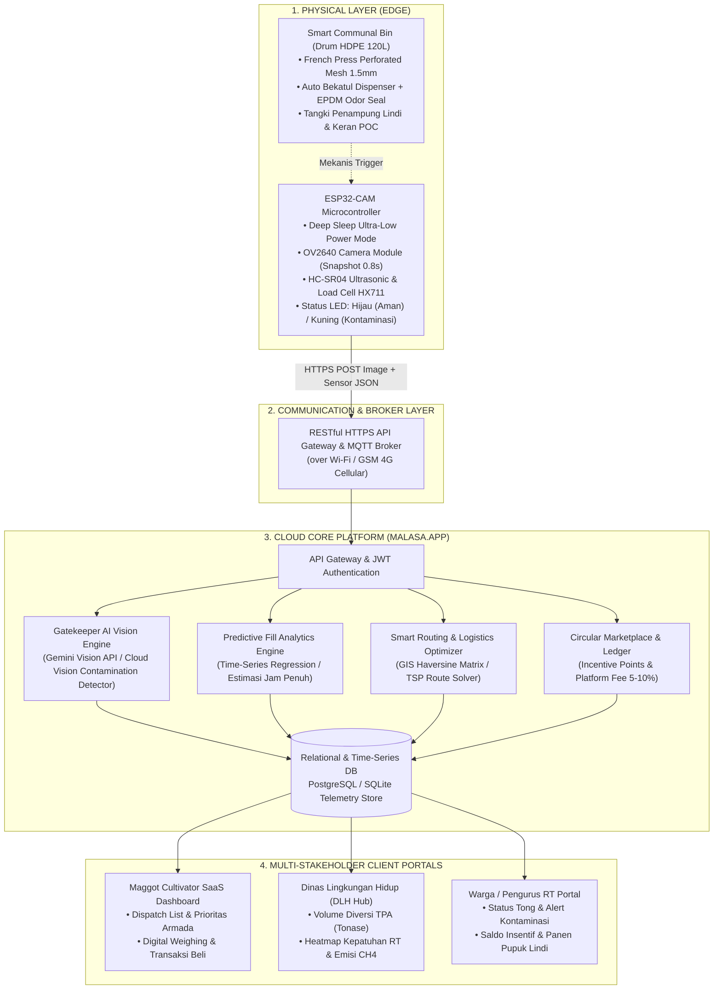

# BLUEPRINT ARSITEKTUR & EKOSISTEM MALASA.APP
**Smart Communal Bin + Gatekeeper AI + Cloud SaaS**
*Disiapkan untuk Sidang Dewan Juri Enov KSKM Universitas Jember*

---

## 1. Executive Summary & Value Proposition

Malasa.App adalah platform terintegrasi hulu-ke-hilir (*end-to-end circular waste ecosystem*) yang mengonversi sampah organik rumah tangga menjadi komoditas pakan bernilai tinggi untuk budidaya larva *Black Soldier Fly* (Maggot BSF), sekaligus memproduksi Pupuk Organik Cair (POC) berkualitas tinggi.

Kelemahan terbesar budidaya maggot konvensional adalah **tingginya risiko mortalitas koloni akibat kontaminasi sampah anorganik (plastik, logam, baterai, kaca)**. Malasa.App menyelesaikan masalah ini pada tingkat sumber melalui:
1. **Desain Mekanis Zero-Friction Habit**: Drum komunal 120L dengan dispenser bekatul otomatis penekan bau dan mekanisme *French Press* untuk dewatering sampah padat & ekstraksi cairan lindi.
2. **Gatekeeper AI (Edge-to-Cloud Vision)**: Validasi optik instan berbasis AI Vision untuk mendeteksi kontaminasi mikro/makro plastik sebelum sampah tercampur.
3. **Smart Logistics & Dynamic Routing**: Penjadwalan armada penjemputan berbasis estimasi waktu penuh (*time-to-full predictive analytics*) dan optimasi rute terpendek (*Vehicle Routing Problem*).
4. **Circular Economy & Digital Marketplace**: Otomasi insentif finansial warga tingkat RT dan penarikan *platform fee* 5%–10% per transaksi.

---

## 2. Diagram Arsitektur Terdistribusi 3-Tier

---

## 3. Alur Kerja Komprehensif (Multi-Tier Workflow)

### Flow 1: Interaksi Mekanis Warga & Reduksi Bau Pasif
1. Warga membuka tutup tong komunal.
2. Mekanisme kawat sling menarik lempeng geser dispenser akrilik, menaburkan $\pm 15\text{ g}$ bekatul/sekam yang telah diinokulasi bakteri EM4 kering untuk mengikat kelembapan dan menekan aroma volatil.
3. Limit switch atau sensor ultrasonik mendeteksi perubahan bukaan, membangkitkan ESP32-CAM dari mode *Deep Sleep*.
4. Warga memasukkan sampah organik dan menutup kembali tutup tong.
5. Seal karet EPDM mengisolasi rongga udara. Gas amonia dialirkan melewati spons karbon aktif.
6. Tuas *French Press* ditekan berkala untuk mengepres sampah; air lindi menetes melewati plat perforated mesh 1.5 mm ke tangki bawah untuk dipanen menjadi Pupuk Organik Cair (POC).

### Flow 2: IoT & Gatekeeper AI Vision
1. ESP32-CAM mengambil foto permukaan sampah setelah jeda stabil (*settle delay* 0.8 detik).
2. ESP32 mengirimkan paket HTTP Multipart (Image + berat Load Cell + ketinggian Ultrasonik).
3. Cloud AI Vision menganalisis sampel gambar untuk mencari kontaminan non-organik:
   - Jika **terkontaminasi** (`is_contaminated == true`): Tong menyalakan indikator LED Kuning, dan sistem mengirim notifikasi peringatan ke WhatsApp/Dashboard Ketua RT.
   - Jika **bersih** (`is_contaminated == false`): Tong menyalakan indikator LED Hijau (kualitas pakan terverifikasi aman untuk koloni larva maggot).
4. Jika kapasitas $\ge 70\%$ atau berat $\ge 5\text{ kg}$, status tong diubah menjadi `CRITICAL / SIAP JEMPUT`.

### Flow 3: Smart Dispatch Logistics & Ekonomi Sirkular
1. Modul *Predictive Analytics* menghitung laju pengisian berdasarkan data time-series, menghasilkan estimasi: *"Tong RT 03 Blok B akan penuh dalam 3.2 jam"*.
2. Modul *Smart Routing* menghitung rute penjemputan armada pembudidaya maggot dengan algoritma VRP berbasis prioritas keterisian dan koordinat geografis.
3. Petugas pembudidaya tiba di lokasi, memverifikasi berat digital, dan mengonfirmasi *weigh-in*.
4. Sistem memotong *platform fee* 5%–10% dan mengkreditkan poin rupiah ke saldo dompet RT/warga secara *real-time*.
