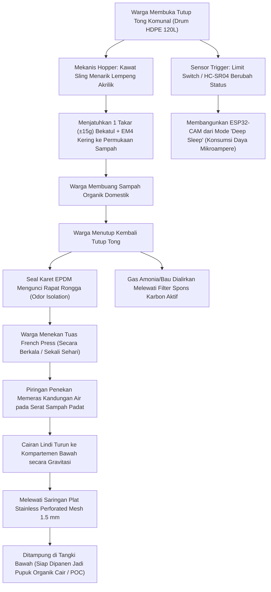
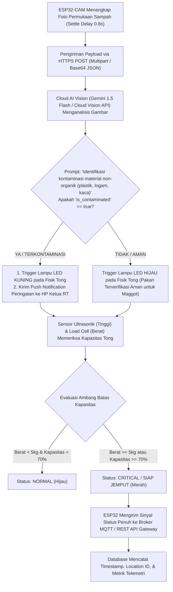
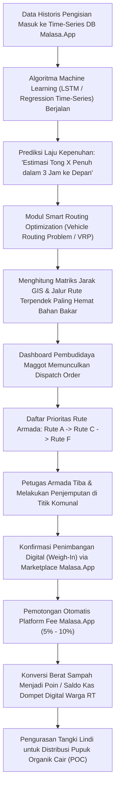

# FLOWCHART & EXECUTIVE WORKFLOW: MALASA.APP ECOSYSTEM
*Smart Communal Bin + Gatekeeper AI + Cloud SaaS*
*Fakultas / Universitas Jember - Enov KSKM*

---

## Diagram Alur 1: Proses Operasional Fisik & Mekanis di Tingkat Warga (Multi-Tier Action)

---

## Diagram Alur 2: Alur Pemrosesan IoT & "Gatekeeper AI" (Cloud Vision Intelligence)

---

## Diagram Alur 3: Alur Logistik Cerdas & Prediksi AI di Malasa.App SaaS

